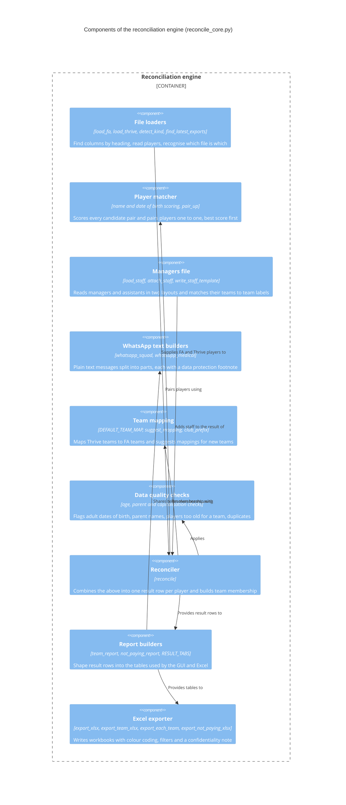
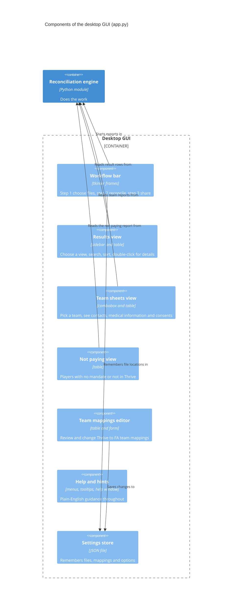

# C4 level 3: components

## Reconciliation engine

| Component | Key behaviour |
| --- | --- |
| File loaders | Locate columns by exact, then starting, then containing heading text. Group FA rows by FAN ID so a player in two teams is one player. Split Thrive team lists on commas and remove duplicates |
| Player matcher | Details in [matching algorithm](matching-algorithm.md) |
| Team mapping | A Thrive team maps to an FA team, to ignore, or is unmapped. Unmapped teams are reported, never silently dropped |
| Data quality checks | Rules listed in [matching algorithm](matching-algorithm.md#data-quality-rules) |
| Reconciler | Classifies each player into a result and records, per team, whether the player is in both systems, FA only or Thrive only |
| Managers file | Tolerant loader found by column headings, with a template writer and a list of unmatched teams and teams without a manager |
| WhatsApp text builders | Build the squad and medical messages from the same team data as the sheets |
| Report builders | One function per report. Both the screen and Excel use them, so what you see is what you export |
| Excel exporter | One shared table writer, so every sheet has the same look and behaviour |

## Desktop GUI

The GUI keeps the loaded players and the latest result in memory. Changing a mapping or the fuzziness recomputes the result from the loaded players, so the files are not read again.
