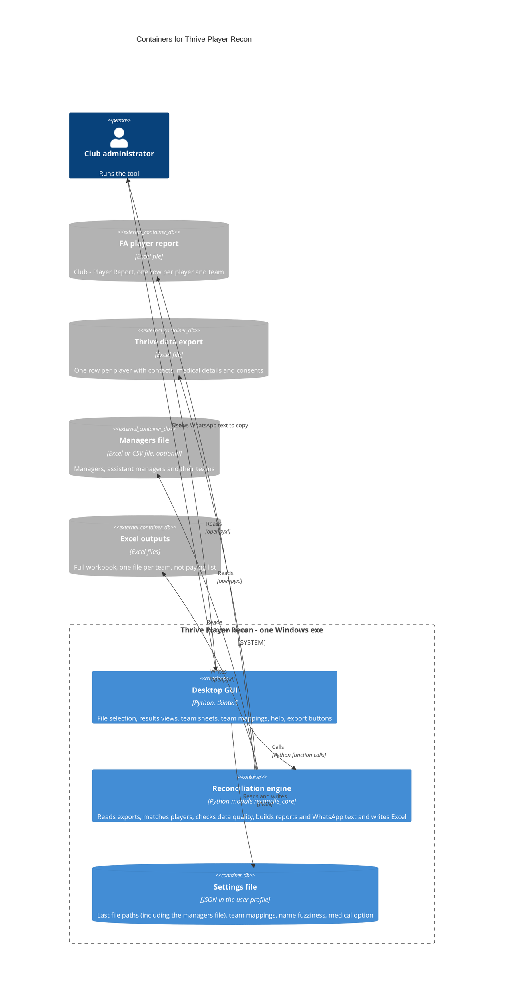

# C4 level 2: containers

The tool ships as one executable, but it is built from three parts with clear responsibilities, plus the files it reads and writes.

## Responsibilities

| Container | Responsibility | Source |
| --- | --- | --- |
| Desktop GUI | Everything the user sees and clicks. Holds the current session state and calls the engine. Contains no matching or reporting logic | `src/app.py` |
| Reconciliation engine | All logic that does not need a screen: reading, matching, data quality, team membership, reports and Excel output | `src/reconcile_core.py` |
| Settings file | Small JSON file at `%APPDATA%\PlayerReconcile\config.json`. Contains no player data | written by `src/app.py` |

## Why the split matters

The engine imports no GUI code, so it can be run and tested without a display and reused by a command line or other front end later. See [decisions](decisions.md).
