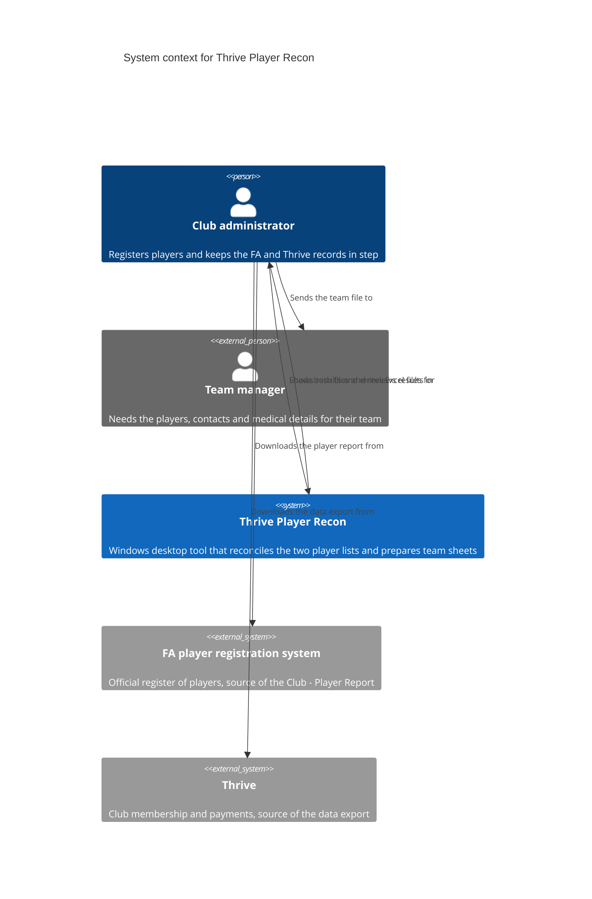

# C4 level 1: system context

The tool sits between two systems the club already uses. The administrator downloads an export from each, loads them into the tool, and passes team files on to managers.

## Notes

- The tool has no live connection to the FA system or Thrive. The administrator moves data by downloading and loading files
- Corrections flow the other way by hand: the administrator fixes the wrong record in the FA system or Thrive
- Managers never use the tool. They receive an Excel file for their own team only
