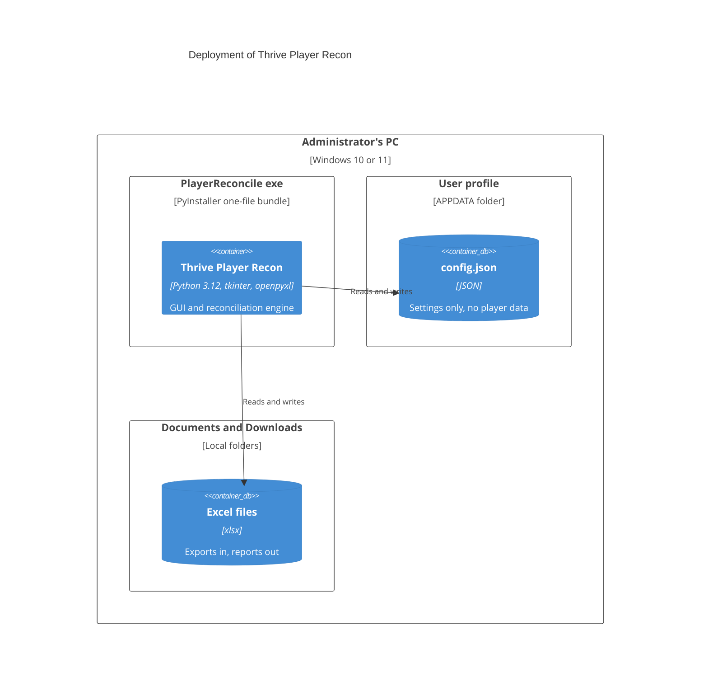
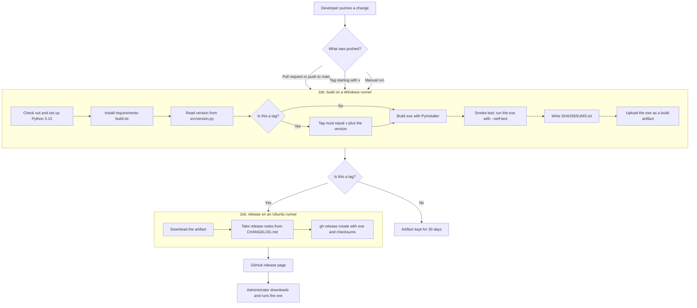

# Deployment and pipeline

## Where the tool runs

The exe runs on the administrator's own Windows PC. Nothing is installed and no server is involved.

## Build and release pipeline

GitHub Actions builds the exe and publishes releases. The workflow is `.github/workflows/build-release.yml`.

## Pipeline design

| Aspect | Choice |
| --- | --- |
| Triggers | Pull requests and pushes to `main` that touch the app, scripts, requirements or the workflow. Version tags. Manual runs |
| Release | Only on tags starting with `v`. The tag must equal `v` plus the version in `src/version.py`, otherwise the build fails |
| Permissions | Read-only by default. Only the release job has `contents: write` |
| Dependencies | Only GitHub's own actions (checkout, setup-python, upload and download artifact) and the `gh` command line. No third-party actions |
| Notes | The release notes are the matching section of `CHANGELOG.md` |
| Integrity | `SHA256SUMS.txt` is published with the exe |
| Check | The built exe is started with `--self-test`, which proves it launches and can write Excel. This is a smoke check, not a test suite |
| Signing | Not signed. See [decisions](decisions.md) |

The release steps for a maintainer are in [../development.md](../development.md#releasing).
