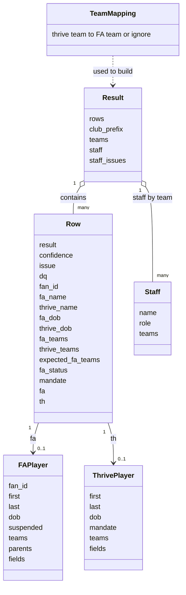

# Data model

The engine works with plain Python dataclasses. Nothing is stored between runs except the settings file.

## Records

| Record | Built from | Notes |
| --- | --- | --- |
| `FAPlayer` | FA report | One per FAN ID. `teams` maps each FA team to its registration status. `fields` holds email, parent or carer, emergency contact and consent |
| `ThrivePlayer` | Thrive export | One per row. `teams` is the de-duplicated list from the comma separated cell. `fields` holds contacts, medical information and consents |
| `Row` | One pairing or one unpaired player | Carries the source records, so reports can reach any field without another lookup |
| `Staff` | A manager or assistant manager from the optional managers file | `kind` is manager, assistant or other, from the role text |
| `Result` | The whole reconciliation | `teams` maps a team label to a list of source and row, where source is Both, FA only or Thrive only |
| Team mapping | Settings file and defaults | A dictionary from Thrive team to FA team name, or to none for ignore |

## Optional field lookup

Thrive fields such as medical information are found by heading text, not position. Each logical field has a list of accepted headings, matched exactly, then by prefix, then by containment. This is what lets the tool cope with extra columns and the club's own wording such as *wwfc photography policy*. The lists are `THRIVE_FIELDS` and `FA_FIELDS` in `reconcile_core.py`.

## Result values

| Result | Level | Meaning |
| --- | --- | --- |
| Matched | ok | Exact name and date of birth, teams agree, nothing flagged |
| Matched (data quality) | warn | Same player, but a data quality flag applies |
| Matched (team differs) | warn | Same player, teams disagree or no active FA registration |
| Check match | warn | Probably the same person, name or date of birth differs |
| Thrive only | bad | Not found in the FA report |
| FA only | bad | Registered with the FA but not found in Thrive |
| Thrive only (expected) | info | Only in teams the mapping ignores, such as U5 and U6 |
| FA only (not registered) | info | FA status is Cancelled or Transferred |
