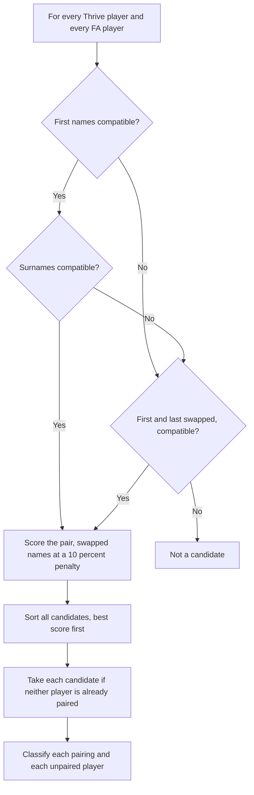

# Matching algorithm

Thrive has no FAN ID, so players are paired on name and date of birth. The aim is to find every probable match while never presenting an uncertain one as certain.

## Overview



Pairing is one to one and greedy by score, so the best matches are settled first and a weaker candidate cannot steal a player from a better one.

## Name scoring

Each name part is scored from 0 to 1 after removing case, accents and punctuation, so *Wroe-Hampson* and *wroehampson* are identical.

| Case | Score | Example |
| --- | --- | --- |
| Identical | 1.00 | Smith and smith |
| One is the start of the other, at least 3 letters | 0.92 | Sam and Samuel, Thomas and Thomas James, Mallaby and Mallaby Beever |
| One is the end of the other, surnames only, at least 4 letters | 0.90 | Beswick and Adamos Beswick |
| Known nickname | 0.90 | Teddy and Edward, Jake and Jacob |
| Close typo, similarity at or above the fuzziness setting | similarity x 0.90 | Walker and Walked |
| Anything else | 0 | Not a candidate |

The nickname table is `NICKNAMES` in `reconcile_core.py`. The fuzziness setting defaults to 0.80 and can be changed in the app between 0.60 and 1.00.

## Date of birth scoring

| Case | Score |
| --- | --- |
| Identical | 1.0 |
| Two of day, month and year agree, or day and month are swapped in the same year | 0.6 |
| Anything else, or a date missing | 0.2 |

A completely different date does not stop a pairing. Thrive sometimes holds a parent's date of birth, and the name still identifies the child.

## Pair score

```text
score = 0.35 x first name + 0.35 x surname + 0.30 x date of birth
```

## Classification

| Situation | Result |
| --- | --- |
| Exact name and exact date of birth | Matched, then checked for team differences and data quality |
| Any difference in name or date of birth | Check match, with both values shown |
| Not paired, only in teams the mapping ignores | Thrive only (expected) |
| Not paired, otherwise | Thrive only or FA only |
| Not paired, FA status Cancelled or Transferred | FA only (not registered) |

A player is confidence **Exact**, **Name differs**, **DOB differs** or **Name and DOB differ**.

## Team comparison

Each Thrive team is mapped to an FA team or ignored. For a paired player the engine compares the mapped Thrive teams with the teams the player is registered in with the FA. A player in several Thrive teams is checked against all of them. Differences are written in plain words, for example *Thrive team U8 Red but not registered in FA*.

For each team, a player is **Both** if the FA and Thrive agree, **FA only** or **Thrive only** if only one does. This drives the colours on the team sheets.

## Data quality rules

| Rule | Detail |
| --- | --- |
| Adult date of birth in Thrive | Age 19 or over today, suggests a parent's details were entered. Constant `ADULT_AGE` |
| Thrive name matches an FA parent or carer | First and last name both score at least 0.90 against a parent name listed in the FA report |
| Player too old for a team | Football age on 31 August before the season is at least the age group of the team. FA date of birth is used when there is one |
| Missing date of birth | Thrive has no date for the player |
| Capitalisation | A name entirely in lower case or upper case, or starting with a lower case letter |
| Possible duplicate | Two records in the same system with the same date of birth and compatible names |
| No active FA registration | Matched player whose FA status is Cancelled or Transferred only |
| Suspended | The FA report marks the player suspended |
