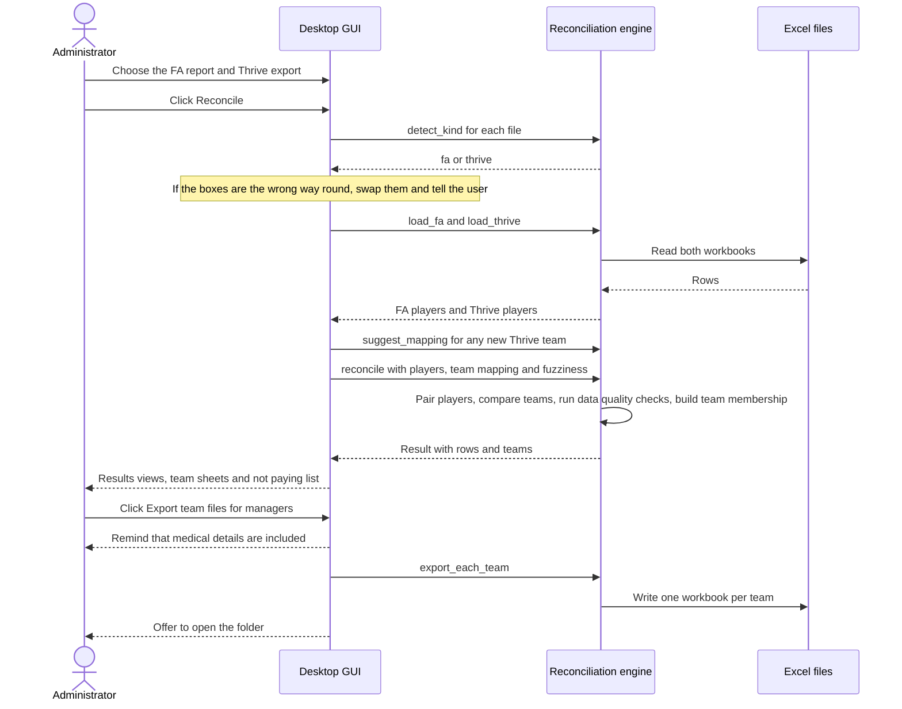
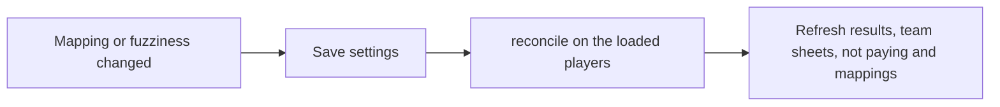

# Runtime flow

## Reconcile and share

This is what happens when the administrator clicks **Reconcile** and then shares team files.

## Changing a setting

Changing a team mapping or the name fuzziness does not reload the files. The GUI keeps the loaded players and calls `reconcile` again, then refreshes every view.

## Error handling

| Situation | Behaviour |
| --- | --- |
| A file is not the expected report | The engine raises `ReportError` naming the file and the columns expected. The GUI shows it in plain English |
| Files in the wrong boxes | Detected from the headings and swapped automatically |
| The output file is open in Excel | The save fails with a message asking the user to close it and try again |
| A Thrive team is not in the mapping | Shown in red on the Team mappings tab and flagged on affected players. Never silently ignored |
| An optional column is missing | The field is left blank and everything else still works |
